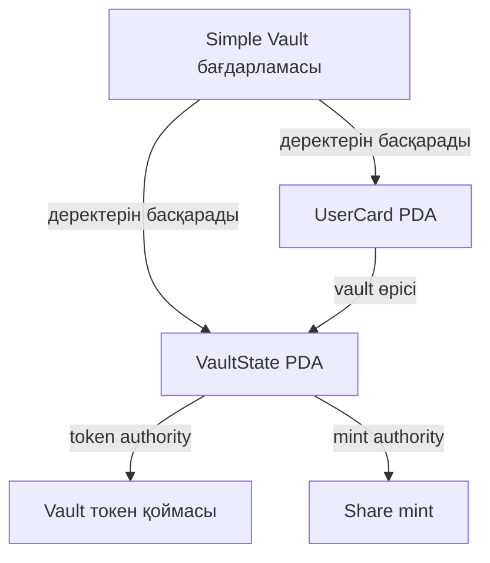

# Simple Vault — практика Anchor

Учебный контракт на Anchor 0.31.1 (Solana). Сейчас он делает три вещи:

1. **Vault создан** — админ создаёт vault для SPL-токена. *(неделя 8)*
2. **У каждого пользователя своя «карточка»** — личный аккаунт (PDA) внутри vault. *(неделя 8)*
3. **Депозит и share-токены** — пользователь вносит токены и получает share-токены. *(неделя 9)*

Контракт будет дорабатываться (вывод, Raydium и т.д.), поэтому он намеренно небольшой.

---

## Что делает контракт

```
initialize_vault    создаёт VaultState PDA, vault token account и share mint
create_user_card    создаёт UserCard PDA — личную карточку пользователя в vault
deposit(amount)     переводит токены пользователя в vault → печатает ему shares
```

### `initialize_vault`

Вызывает админ (платит за аккаунты). Создаёт три аккаунта для выбранного `token_mint`:

| Аккаунт | Seeds | Что хранит |
|---|---|---|
| `vault_state` | `["vault", token_mint]` | admin, token_mint, адреса token account и share mint, `total_tokens`, `total_shares`, bump |
| `vault_token_account` | `["vault_tokens", token_mint]` | токен-аккаунт, владелец — vault PDA |
| `share_mint` | `["share_mint", token_mint]` | mint для shares (6 decimals), authority — vault PDA |

### `create_user_card`

Вызывает любой пользователь (платит за свою карточку). Создаёт `UserCard`:

| Поле | Описание |
|---|---|
| `vault` | к какому vault относится карточка |
| `owner` | владелец карточки |
| `deposited` | сколько токенов пользователь внёс всего |
| `shares` | сколько share-токенов он получил |
| `bump` | bump PDA |

Seeds: `["user_card", vault_state, user]` — поэтому у одного пользователя в одном vault
может быть **только одна** карточка. Повторный вызов завершится ошибкой.

### `deposit(amount)`

Пользователь вносит `amount` токенов и получает share-токены — «квитанции» с его долей в vault.
**Депозит возможен только после `create_user_card`** — без карточки инструкция вернёт ошибку.

Что происходит по шагам:

1. Считается, сколько shares положено пользователю.
2. Токены переводятся с токен-аккаунта пользователя в `vault_token_account`.
3. Vault печатает shares на share-аккаунт пользователя (подписывает сам vault PDA).
4. Обновляются `total_tokens` и `total_shares` в vault, а также `deposited` и `shares` в карточке.

**Формула shares:**

```
Первый депозит:       shares = amount                         (1:1)
Последующие депозиты: shares = amount × total_shares / total_tokens
```

Пример: A вносит 100 токенов → получает 100 shares. Потом B вносит 50 → получает 50 shares.
В vault 150 токенов и 150 shares, у A доля 2/3, у B — 1/3.

Ошибки: `ZeroAmount` (сумма 0), `SharesTooSmall` (депозит слишком мал, shares вышло бы 0), `MathOverflow`.

Для вызова `deposit` нужны: токен-аккаунт пользователя (с токенами vault) и share-аккаунт пользователя
(для share mint). В тестах они создаются через `createAccount` из `@solana/spl-token`.

---

## Требования

| Инструмент | Версия | Установка |
|---|---|---|
| Rust | stable | https://rustup.rs |
| Solana CLI | 1.18+ | https://docs.solana.com/cli/install-solana-cli-tools |
| Anchor CLI | 0.31.1 | `cargo install --git https://github.com/coral-xyz/anchor avm --locked && avm install 0.31.1 && avm use 0.31.1` |
| Node.js | 18+ | https://nodejs.org |
| Yarn | any | `npm i -g yarn` |

Rust-зависимости (`anchor-lang`, `anchor-spl` 0.31.1) подтянутся сами при `anchor build`.
JS-зависимости (`@coral-xyz/anchor`, `@solana/web3.js`, `@solana/spl-token`, `mocha`, `chai`, `typescript`) — через `yarn install`.

---

## Быстрый старт

### 1. Установить зависимости

```bash
cd vault-simple
yarn install
```

### 2. Сбилдить контракт

```bash
anchor build
```

Если билдишь **первый раз** (новый keypair):

```bash
anchor keys sync   # обновит declare_id! в lib.rs и Anchor.toml
anchor build       # пересобрать с правильным ID
```

Артефакты в `target/deploy/`:
- `simple_vault.so` — программа
- `simple_vault-keypair.json` — keypair (не коммитить!)

### 3. Настроить Solana CLI на devnet

```bash
solana config set --url devnet
solana address     # твой публичный ключ — запомни его
solana balance
```

### 4. Пополнить кошелёк

Для деплоя нужно ~2 SOL.

```bash
solana airdrop 2   # может не сработать из-за rate limit
```

Если rate limit — используй faucet:
- https://faucet.solana.com (вставь свой адрес)

### 5. Задеплоить

```bash
anchor deploy --provider.cluster devnet
```

### 6. Запустить тесты

```bash
yarn test
```

Ожидаемый вывод:

```
✔ initialize_vault: vault создан
✔ create_user_card: у каждого пользователя своя карточка
✔ create_user_card: вторая карточка для того же пользователя — ошибка
✔ deposit: A вносит 100 токенов → получает 100 shares
✔ deposit: B вносит 50 токенов → получает 50 shares
✔ deposit: без карточки — ошибка
✔ deposit: сумма 0 — ошибка
7 passing
```

---

## Структура проекта

```
vault-simple/
├── programs/simple_vault/src/lib.rs   # контракт
├── tests/vault.ts                     # тесты
├── Anchor.toml
├── Cargo.toml
└── package.json
```

---

## Частые ошибки

| Ошибка | Причина | Решение |
|---|---|---|
| `Insufficient funds` при деплое | мало SOL | пополни кошелёк на devnet |
| `AccountNotInitialized` в тестах | программа не задеплоена или другой ID | `anchor keys sync` → `anchor build` → `anchor deploy` |
| `already in use` при `create_user_card` | у пользователя уже есть карточка | это ожидаемо, карточка одна на пользователя |
| `AccountNotInitialized` (`user_card`) при `deposit` | нет карточки | сначала вызови `create_user_card` |
| `ZeroAmount` | `amount = 0` | вноси сумму больше нуля |
| `SharesTooSmall` | депозит слишком мал относительно vault | увеличь сумму |
| `429 Too Many Requests` | лимит публичного devnet RPC | подожди или возьми свой RPC |

---

## Задания для практики

1. Добавить комиссию 1% на депозит и отправлять её на `fee_wallet`.
2. Добавить минимальный депозит (например, 1 токен).
3. Добавить флаг `paused` в `VaultState`: админ может остановить депозиты.
4. Написать тест: трое пользователей вносят разные суммы, проверить доли по shares.

## 8-апта — Liquidity Vault қаңқасы

### Орындалған жұмыс

- Бағдарлама devnet желісіне орналастырылды.
- initialize_vault арқылы VaultState, токен қоймасы және share mint құрылды.
- create_user_card арқылы екі пайдаланушының жеке PDA карточкасы құрылды.
- Бір пайдаланушыға екінші карточка ашу әрекеті қабылданбады.
- Шаблондағы 7 тест сәтті өтті. Оның ішінде 9-аптаға арналған депозит тесттері де бар.

### Аккаунттар схемасы



VaultState және UserCard аккаунттарының Solana owner-і — біздің бағдарлама.
Токен қоймасы мен share mint аккаунттарының Solana owner-і — SPL Token Program.
Қоймадағы токендерді басқару және share-токен шығару өкілеттігі VaultState PDA-ға берілген.

### PDA seeds

| Аккаунт | Seeds |
|---|---|
| VaultState | ["vault", token_mint] |
| Токен қоймасы | ["vault_tokens", token_mint] |
| Share mint | ["share_mint", token_mint] |
| UserCard | ["user_card", vault_state, user] |

UserCard адресі vault пен пайдаланушы адресінен есептеледі.
Сондықтан бір vault ішінде әр пайдаланушының бір ғана карточкасы болады.
PDA-ның жеке кілті жоқ; бағдарлама тиісті seeds арқылы CPI кезінде оның атынан қол қоя алады.

### Devnet сілтемелері

- [Бағдарлама](https://explorer.solana.com/address/3gXDYQzb7iEjuVQVS5mxnzF9y6DgkBjKUpgxSJF9APzN?cluster=devnet)
- [VaultState](https://explorer.solana.com/address/2SmkpaVZUaVZGALVaPsY3XJL9xjx9Ambh56UkNaPqY7A?cluster=devnet)
- [Қабылданатын токен mint](https://explorer.solana.com/address/6cRtG2KVL9q4UHxviytJS8x5BT1FjLckAraNcWVkcrMX?cluster=devnet)
- [Токен қоймасы](https://explorer.solana.com/address/CEZbQmzkpCYoveg5FrtqZk7gF32TEGHd2SzYq8Ex9sVE?cluster=devnet)
- [Share mint](https://explorer.solana.com/address/Ey4zwC7amaUvQFj3H4Thvk5tYwJDJsqdE1NXxU7bYzBk?cluster=devnet)
- [Бірінші пайдаланушы карточкасы](https://explorer.solana.com/address/3qSAGadwRRD8iw3tYJBpkMCCQkD7GLwbLmwoFN6v9zxc?cluster=devnet)
- [Екінші пайдаланушы карточкасы](https://explorer.solana.com/address/CirsoChvobeAVqZm9soJbBnC6C8qEFMVotUAQKQYDzBB?cluster=devnet)

### Тексеру нәтижесі

yarn test: 7 passing.

Тесттерден кейінгі жалпы есеп:
150000000 ең кіші бірлік = 150 токен;
150000000 ең кіші бірлік = 150 share-токен.

## 9-апта — Депозит және share-токендер

### Депозиттің жұмысы

Шаблондағы deposit(amount) функциясы devnet желісінде тексерілді.

1. Пайдаланушы алатын share-токен саны есептеледі.
2. SPL Token Program арқылы пайдаланушыдан vault қоймасына токен аударылады.
   Аударымды пайдаланушы өз қолымен растайды.
3. VaultState PDA өкілеттігімен пайдаланушыға share-токендер шығарылады.
4. VaultState ішіндегі total_tokens және total_shares, сондай-ақ UserCard
   ішіндегі deposited және shares өрістері жаңартылады.
5. Нөлдік депозит қабылданбайды.

### Share есептеу

Алғашқы депозит: shares = amount.
Келесі депозиттер: shares = amount × total_shares / total_tokens.
Есеп депозит енгізілгенге дейінгі мәндермен орындалады.

Егер vault табыс тауып, токен саны өссе, share бағасы артады.
Сондықтан кейінгі салымшы енгізген токенінен аз share алуы мүмкін.
Біздің тестте табыс қосылмағандықтан, қатынас 1:1 болды.

### Тексеру нәтижелері

- A пайдаланушысы: 100 токен енгізді, 100 share алды.
- B пайдаланушысы: 50 токен енгізді, 50 share алды.
- Жалпы: 150 токен және 150 share.
- Карточкасыз депозит қабылданбады.
- Нөлдік депозит қабылданбады.
- Барлық 7 тест өтті.

### Explorer дәлелдері

[100 токендік депозит](https://explorer.solana.com/tx/5eCtpK2wsobBDHXCrDmUH5quZgu1nG2BBTihq6caQm46f3GVNvwhQ1Sb6Tbwaj4SYTyrrRAGJfi8mgmPMwGNMZUT?cluster=devnet)

[50 токендік депозит](https://explorer.solana.com/tx/3oKiCqtHo8P2SzSXWkvjVBSFJd56Sp8BoUkTs67smQHy2NFMSVF2oMJYgjJqebpc5NEMmcVrHgQ1HU2UGrGJLgsD?cluster=devnet)

50 токендік депозиттің статусы — Success / Finalized.
Транзакцияда Simple Vault бағдарламасы SPL Token Program бағдарламасын
CPI арқылы екі рет шақырған: Transfer және Mint To.
Transfer authority — пайдаланушы; Mint To authority — VaultState PDA.

## 10-апта — CPI және vault-тан токен шығару

`withdraw(shares_amount)` пайдаланушының share-токендерін сөндіріп, оның үлесін қоймадан қайтарады. Шығарылатын токен саны операцияға дейінгі мәндермен есептеледі:

`tokens_out = shares_amount × total_tokens / total_shares`

CPI — бір бағдарламаның басқа бағдарламаны шақыруы. Explorer-дегі `Inner Instructions` бөлімінде Simple Vault бағдарламасының SPL Token Program-ға жасаған екі шақыруы көрінеді:

1. **Burn** — пайдаланушының 50 share-токені сөндіріледі. Операцияны пайдаланушы өз әмиянымен растайды.
2. **Transfer** — қоймадан пайдаланушының токен аккаунтына 50 токен аударылады. Қойманы басқару құқығы VaultState PDA-ға берілген, сондықтан аударымды бағдарлама сол PDA атынан растайды.

A пайдаланушысы 50 токен шығарғаннан кейін vault-та 100 токен және 100 share қалды. B өзіндегі 50 share-токеннің бәрін қайтарды. Осыдан кейін vault-та 50 токен және 50 share қалды.

- [A пайдаланушысының шығару транзакциясы](https://explorer.solana.com/tx/LHLpD4nwk6X4P4fGMvF4uZwbWUg9KDsiqHzXQgfd1nKH828RNBFmZkiijm2xFf2tybcB4QdTVdamHwgSzPKSG2r?cluster=devnet)
- [B пайдаланушысының шығару транзакциясы](https://explorer.solana.com/tx/2aYSRUNzcJcyLag52b8i93oqYKmLtVdHoFLxArEdevwnDjigsxLPhvmYTgfqu4CxSgiwpJCFev5uCVtaFAXimfQD?cluster=devnet)

Бағдарлама devnet-ке сәтті жүктелді. `yarn test` нәтижесі — `12 passing`. Нөлдік сомамен, баланстан артық және карточкасыз шығару әрекеттері қабылданбады.

## 11-апта — Өз токендерім және Raydium CLMM пулы

Ағайдың create-clmm-pool.ts скриптімен Solana devnet желісінде
екі SPL-токен мен Raydium CLMM пулын құрдым.
Әр токеннің дәлдігі 6 ондық таңба, әрқайсысынан 1 000 000 шығарылды.

- TOKEN_A — `GRfDuvwzySPT4oN3ZU6CK8keQNw5UhVDzHpXmzQFPcou`
- TOKEN_B — `4iVa91kmR9xthMY4xUueGt4iyAXXjDUr9nSUB49DGU5r`
- Пул — `FWHDW6erKmWytfLFF2Mcuq9maBYLEEy847EGmNPunMUB`
- Комиссия конфигурациясы — `CD4aJtX11cqTCAc83nxSPkkh5JW2yjD6uwHeovjqQ1qu`
- Raydium бағдарламасы — `DRayAUgENGQBKVaX8owNhgzkEDyoHTGVEGHVJT1E9pfH`

Бастапқы баға 1 TOKEN_A = 1 TOKEN_B.
Тик қадамы 60, сауда комиссиясы 0.25%.

CLMM-де өтімділік таңдалған баға диапазонында жұмыс істейді.
Баға диапазоннан шыққанда позиция комиссия жинауды тоқтатады.

Тәуелділіктерді сәйкестендіргеннен кейін TypeScript тексеруі өтті.
Скрипттің нәтижелері devnet-pool.json файлына сақталды.

[Пулды Explorer-де ашу](https://explorer.solana.com/address/FWHDW6erKmWytfLFF2Mcuq9maBYLEEy847EGmNPunMUB?cluster=devnet)

[Пул құру транзакциясы](https://explorer.solana.com/tx/3XvpEVzNDhqoRdTjpuQvrMsTtFojodw2CWovRAwx3gVUWRkns8qcJBsAVEZX8WAAByLrtTGCDZVMZ2qCeEzaRQMR?cluster=devnet)

### PDF әдістемесі бойынша өтімділік позициясын ашу

`scripts/open-clmm-position.ts` бұрын құрылған пулды `devnet-pool.json` файлынан оқиды.
Пулдың актуалды бағасы мен аккаунттары devnet RPC арқылы алынады.
Позицияға негізгі токеннен 100 бірлік параметрі беріліп, екінші токеннің ең үлкен мөлшері
1% slippage арқылы есептеледі. Баға диапазоны ағымдағы бағадан шамамен 10% төмен және
10% жоғары таңдалып, пулдың тик қадамына сәйкестендіріледі.

Ubuntu немесе WSL терминалында орындау

```bash
yarn open-position --simulate
yarn open-position
```

`--simulate` режимі ашық әмиян адресімен транзакцияны желіде симуляциялайды.
Негізгі іске қосуда `ANCHOR_WALLET` не `~/.config/solana/id.json` әмияны қолданылады.
RPC адресін `DEVNET_RPC` айнымалысымен көрсетуге болады.

Сәтті операциядан кейін позиция NFT-і, personal position, protocol position, tick array,
пул қоймалары мен observation аккаунты `devnet-pool.json` файлына қосылады.
README-де нақты диапазон, оны таңдау себебі және Explorer сілтемелері автоматты түрде жазылады.

Қайта іске қосу бұрын ашылған позицияны тексеріп, нәтижелерді жаңартады.
NFT mint кілті мен позиция жоспары қалпына келтіру үшін жергілікті `.anchor/week11-position/`
бумасына сақталады. Ubuntu-дағы `flock` бір уақытта бір іске қосуды қамтамасыз етеді.

Негізге алынған ресми мысал — [Raydium CLMM createPosition](https://github.com/raydium-io/raydium-sdk-V2-demo/blob/master/src/clmm/createPosition.ts).
Код жобадағы `0.2.41-alpha` SDK интерфейсіне сәйкестендірілді.

<!-- week11-position:start -->
### 11-аптадағы өтімділік позициясы

Бар CLMM пулында өз әмиянымнан бір өтімділік позициясын аштым.
Негізгі токеннен 100 бірлік енгізу параметрі және екінші токенге 1% slippage шегі қолданылды.
Баға Raydium пулындағы бір mintA токеніне шаққандағы mintB мөлшерімен көрсетілген.

- Пулдың mintA токені — `4iVa91kmR9xthMY4xUueGt4iyAXXjDUr9nSUB49DGU5r`
- Пулдың mintB токені — `GRfDuvwzySPT4oN3ZU6CK8keQNw5UhVDzHpXmzQFPcou`
- Тексеру кезіндегі баға — 1.000000000000
- Диапазон — 0.897632443309 — 1.100753780715
- Тиктер — -1080 — 960
- Позиция өтімділігі — `2133837462`
- [Позиция аккаунты](https://explorer.solana.com/address/EkSzkpJ1oZtDy5PsREvozLDRnB9zas7WA3bi1cnJyZt1?cluster=devnet)
- [Позиция NFT mint](https://explorer.solana.com/address/3pp3dyJW2tPFmwE7fcSmX6cPe7pj61goaqkS3Zs35gDX?cluster=devnet)
- [NFT токен аккаунты](https://explorer.solana.com/address/4YPMMtLFczdWsW1ENzMsGmat1C9A38Eo3XXUyjjVvexu?cluster=devnet)
- [Төменгі tick array](https://explorer.solana.com/address/HCvhr6qrWDf1WCEv2BHr3WEPgmwSxb5setD1uKfAYxNj?cluster=devnet)
- [Жоғарғы tick array](https://explorer.solana.com/address/2GDmwLgBsd6LGcfmguvMiTHbWnmFXYJfw7BVstr1vC1Q?cluster=devnet)
- [Пулдың vaultA аккаунты](https://explorer.solana.com/address/5w4fDS4LWJHSAK7ivPcL2S7MkmayCHgBeAyo5DvE5Rce?cluster=devnet)
- [Пулдың vaultB аккаунты](https://explorer.solana.com/address/4HjmtkU56k8gsAcPM2VPUmNTwy9iVzH7Mfqh4YuZzfKH?cluster=devnet)
- [Observation аккаунты](https://explorer.solana.com/address/7JusnWjCR5f2G383yJYb49xGurYCGHGVpqWDP6NWa99z?cluster=devnet)
- [Позиция ашу транзакциясы](https://explorer.solana.com/tx/3bR3MAVgaLVtAnBv2HdNGLaY8QLghXkNKLasVqP9v9nHsSMrUHpGPqm7Ti4dY1rUdrktJWrS41XpE8pfoMY2fuwT?cluster=devnet)

Ағымдағы бағадан шамамен 10% төмен және 10% жоғары аралықты таңдадым. Бұл бағаға екі жаққа қозғалу мүмкіндігін береді және өтімділікті нақты аралыққа шоғырландырады. Шекаралар пулдың тик қадамына сәйкестендірілді.

Позиция мен пул аккаунттарының адрестері devnet-pool.json файлына қосылды.
<!-- week11-position:end -->
